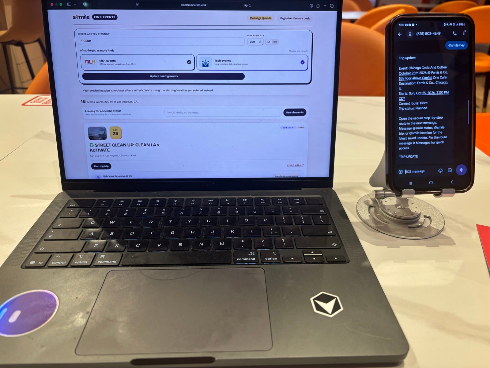

# S’mile

> Every mile ends in a smile.

I built S’mile because getting to a hackathon should not feel harder than building at one. Pick an event, compare realistic ways to get there, follow the trip on a live map, and keep the same plan in a private `@smile` iMessage conversation. When the trip ends, the organizer receives the evidence needed to review and close the reimbursement.

[Try S’mile](https://smilefromhereto.work/landing) | [Find an event](https://smilefromhereto.work/finding-events) | [Open the organizer desk](https://smilefromhereto.work/desk)



<p align="center"><em>S’mile running at Cal Hacks, with event discovery on the web and the same trip delivered through @smile.</em></p>

## What S’mile does

1. **Find an event.** Start with a ZIP code or a U.S. city and state, then search live public event listings.
2. **Compare the whole trip.** S’mile shows the fastest option, useful alternatives, estimated price, time, emissions, and missed-kickoff risk.
3. **Approve the exact amount.** A model can explain evidence, but it cannot invent or approve a fare. If a verified price changes, the traveler must approve the new amount.
4. **Travel with clear guidance.** The map follows real route geometry, numbered steps, multimodal legs, and GPS progress when the traveler grants location access.
5. **Close the trip.** Receipt, check-in, approval, and settlement evidence move into the organizer finance workflow.

## The Hyphenate track after the trip

Yes. The post-trip workflow is the part I built for the Hyphenate track. It is an autonomous finance system inside the S’mile organizer desk. It is not a Hyphenate API integration.

**Seats: Travel Reimbursement Clerk + Card Reconciliation Analyst, both reporting to the organizer’s controller.**

Here is how the two seats work together:

1. The **Travel Reimbursement Clerk** reads the approved trip, receipt, check-in, organizer policy, and any fare change. It decides what can be reimbursed and sends the right exception to the right person.
2. The **Card Reconciliation Analyst** matches the receipt and approved amount to card or bank evidence. It catches duplicate requests, split charges, missing proof, and settlement differences.
3. The system posts only balanced double-entry journal entries with references to the evidence and policy rule behind the decision.
4. If the records disagree, the system does not guess. It pauses, asks one specific question, records the answer, and continues from the same trip.
5. The controller can review open exceptions, the trial balance, control totals, carbon totals, and close readiness from one desk.

The important moment is when something goes wrong. S’mile blocks self-approval, refuses a changed price without fresh traveler approval, catches duplicates, and will not post an unbalanced entry. Every action enters a hash-chained audit trail so someone can ask what happened later and get an answer tied to a source, rule, or person.

This follows the Hyphenate brief closely: realistic messy records, limited access, work that continues over time, segregation of duties, explainable decisions, and a clear human escalation when judgment is required.

## What is real and what is simulated

| Real in the working system | Simulated in the demo |
|---|---|
| Event discovery from public pages when a source is available | No ticket is purchased automatically |
| OpenStreetMap place data and map tiles, plus OSRM road routes and steps | The end-of-ride amount is entered by the traveler for the demo |
| Browser GPS progress after permission | The generated receipt is marked simulated and is not valid reimbursement evidence |
| A Photon worker for private one-to-one `@smile` iMessage conversations when the dedicated line is configured | Visa capture is disabled, so no card charge or payout occurs |
| Deterministic approval checks, finance policy, reconciliation, balanced ledger entries, and audit history | Public finance scenarios use demonstration records unless a real organizer connects its own sources |
| Live weather and fare evidence when the configured public source returns it | Price predictions are planning estimates, never an approvable fare |

The finance decisions are real code with automated tests. The public demo does not move real money. A production organizer would connect verified receipts, bank or card settlements, identity, and payout systems before using it for real reimbursements.

At the last route step, S’mile can create a downloadable summary of the simulated ride payments recorded during that journey. This final demo receipt stays separate from finance and is never reimbursement evidence. After the traveler confirms the summary, an authenticated map completion starts organizer attendance review. Ending guidance early creates neither record.

## Demo

- [Start at the landing page](https://smilefromhereto.work/landing)
- [Find nearby events](https://smilefromhereto.work/finding-events)
- [Open the route map](https://smilefromhereto.work/map), after creating or receiving a trip
- [Explore the Cal Hacks venue concept](https://smilefromhereto.work/venue)
- [Explore the LA Hacks venue concept](https://smilefromhereto.work/tour)
- [Review the organizer finance desk](https://smilefromhereto.work/desk)

The venue models are approximate concepts, not verified floor plans or accessibility instructions.

## Why I think it is useful

- One trip record stays connected from event discovery to route guidance to finance close.
- Travelers can compare speed, cost, emissions, and risk instead of receiving one unexplained answer.
- Agents have narrow permissions. The concierge cannot approve, charge, or post to the ledger.
- Scheduled workers can revisit prices, weather, event changes, and reconciliation without changing an approved amount.
- A human remains responsible for the exact price and every exception that needs judgment.

## Built with

| Part | Technology |
|---|---|
| Web app | React, TypeScript, Next.js, CSS |
| Server | Node.js, TypeScript, SQLite, PostgreSQL adapter |
| Maps and routing | Leaflet, OpenStreetMap, OSRM |
| Private trip chat | Photon 2.0 iMessage transport |
| Reasoning and extraction | Anthropic tool use with deterministic amount checks |
| Live public evidence | Bright Data, Google Flights pages, Open-Meteo, public transit and fare sources |
| Finance controls | S’mile’s Hyphenate track implementation, double-entry ledger, policy engine, audit chain |
| Payment demo | Visa sandbox authorization with capture disabled |
| Venue walkthroughs | Three.js and a checked-in GLB model |

## Repository map

```text
frontend/           Next.js web app, map, venue tours, and Chrome extension
backend/            Agents, routing, finance controls, ledger, and Photon worker
backend/claude/     Anthropic client, model configuration, and Claude safety boundary
backend/hyphenate/  The two-seat finance workflow, policy, audit, and reconciliation
tests/              Frontend, backend, agent, and full-system checks
.github/workflows/  Continuous integration
docs/images/        README images
```

## Run it

Node.js 22 or newer is required.

```bash
npm ci --prefix backend
npm ci --prefix frontend
npm ci --prefix tests
cp backend/.env.example backend/.env
npm run seed --prefix backend
npm run dev --prefix frontend
```

The app prints its development address. Sponsor credentials are optional for local development. Missing live services stay unavailable instead of being replaced with invented data. Keep every secret in `backend/.env` and never commit it.

## Test it

```bash
npm run typecheck --prefix backend
npm test --prefix backend
npm run typecheck --prefix frontend
npm test --prefix frontend
npm run build --prefix frontend
```

For the full HTTP workflow, start the frontend, then run:

```bash
npm run test:system --prefix backend
```

The test suite covers role isolation, exact-price approval, fare changes, duplicate requests, balanced journal entries, audit integrity, Photon retries, route handoffs, and repository safety checks.

## Safety boundaries

- Human approval is required for an exact verified trip price.
- AI output cannot directly approve, charge, reimburse, or post an amount.
- The person or system that requests a spend cannot approve the same action.
- Scheduler notices never change a price or approve anything.
- Precise browser coordinates stay in page memory and disappear after a full refresh.
- Secrets, databases, generated builds, and dependency folders stay out of Git.
